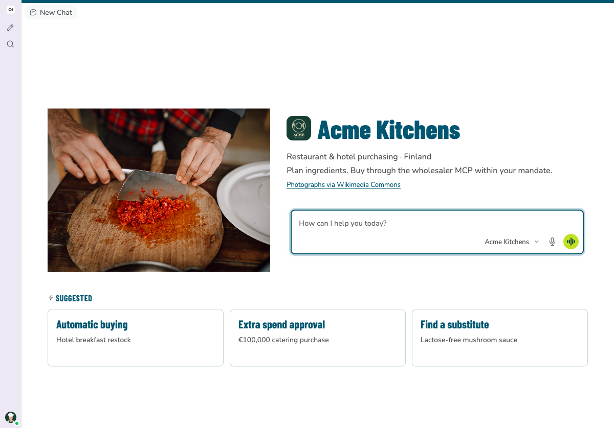
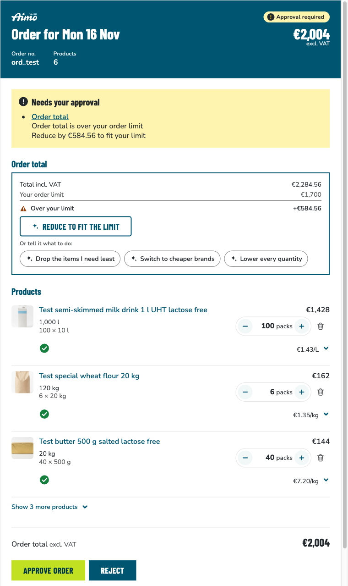
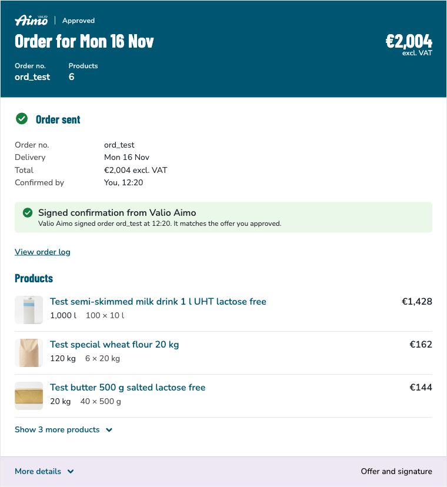
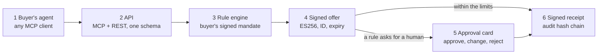

# Trusted Trade Agents

An open ordering service that a wholesaler hosts for the buyer's AI agent.
The agent searches the catalogue, gets signed offers and places orders.
The buyer's mandate sets the limits, the wholesaler's server checks them on every order, and a person decides every exception.

Built for the Valio Aimo challenge at Junction 2026 ([challenge brief](docs/challenge.md)).

**Pitch video:** [YouTube](https://www.youtube.com/watch?v=DtxJx4MbsQQ) · **Deck:** [slides (PDF)](docs/trusted-trade-agents-slides.pdf)



| A person decides the exception                                                                                           | The wholesaler signs the confirmation                                                       |
| ------------------------------------------------------------------------------------------------------------------------ | ------------------------------------------------------------------------------------------- |
|  |  |

The cards show invented products from the view fixtures.

## Try it

| What                    | Where                                                                    |
| ----------------------- | ------------------------------------------------------------------------ |
| Wholesaler service      | [199-247-4-99.sslip.io](https://199-247-4-99.sslip.io)                   |
| Buyer chat (Open WebUI) | [chat.199-247-4-99.sslip.io](https://chat.199-247-4-99.sslip.io)         |
| Approvals               | [/approvals](https://199-247-4-99.sslip.io/approvals)                    |
| Wholesaler activity     | [/activity](https://199-247-4-99.sslip.io/activity)                      |
| MCP endpoint            | `https://199-247-4-99.sslip.io/mcp` (streamable HTTP, no authentication) |

In the chat, sign in as `chef@localhost.invalid` (ask the team for the password) and select Acme Kitchens or Acme Bakery.
Then ask for an order, for example "1,000 litres of lactose-free milk by Monday".
Any other MCP client can connect to the MCP endpoint.

## How it works



Steps 1 to 4 happen on every request. Step 5 shows up only when a rule asks for a person, for example over the limit, a substitute product or a split delivery.

### The server checks the rules

An agent can't skip a check or approve its own order: only the approval card can see the decision tools.
Thirteen reason codes send an order to a person, for example spend limit or unconfirmed allergen, and eight reject it.

The demo mandate:

| Limit                 | Setting                       |
| --------------------- | ----------------------------- |
| Order total           | Max €200 incl. VAT            |
| Categories            | Any                           |
| Substitutes           | Ask                           |
| New products          | Ask                           |
| Delivery reliability  | At least 90%                  |
| CO2                   | Max 3 kg per kg               |
| Allergen data missing | Ask                           |
| Payment               | Invoice OK, pay on order asks |
| Origin                | Prefer Finnish                |

### Signed offers, signed receipts

- **Offers are signed.** ES256, with an ID and an expiry. Anyone can check an offer with the public key.
- **Orders need a valid offer.** The offer fixes the price. Each offer works once.
- **Receipts are chained.** Each receipt signs the latest entry in the SHA-256 audit hash chain, so later edits show.

### The person can change the order

- **Fix it instead of rejecting it.** Change amounts or products, or trim the order to the limit. The server checks it again.
- **When stock runs short.** Part from stock plus a ranked substitute, or a split delivery.
- **The card shows the rules.** The card names each rule the order hit and what it asks the person to check.

### The buyer's answers become rules

Approve the same substitute three times, and the card asks: "Let the agent do this without asking?"

- **Yes** adds a rule to the buyer's mandate. That substitute goes through from then on, and the audit log says why.
- **Don't suggest again** is a rule too. That substitute is blocked.
- **Only the buyer changes the rules**, in the agent limits view. The agent can't add or remove them.

### Any agent can connect

The approval card and the other views (search results, offer comparison, agent limits, order timeline) run inside the chat as MCP App views. Valio Aimo controls how they look. They are in English and Finnish.
We tested Open WebUI and ChatGPT (text) and Claude (voice).

[Implementation and partner technologies](docs/implementation.md) describes the design in more detail.
[Specs](docs/specs.md) is the contract, and the [PRD](docs/prd.md) is the product scope.

## Open contract

Every wholesaler publishes one discovery file on its own domain. It links everything else.

| What               | Path                                      |
| ------------------ | ----------------------------------------- |
| Discovery document | `/.well-known/trusted-trade.json`         |
| OpenAPI 3.1 (REST) | `/api/discovery/openapi.json`             |
| MCP endpoint       | `/mcp`                                    |
| Offer signing keys | `/.well-known/jwks.json`                  |
| Agent skill        | `/skills/trusted-trade-ordering/SKILL.md` |

```sh
BASE_URL=https://199-247-4-99.sslip.io
curl -s "$BASE_URL/.well-known/trusted-trade.json" | jq '{endpoint, mcp, jwksUri, openapi, skill}'
```

The REST and MCP schemas come from the same contract ([SPEC-014](docs/specs.md#spec-014-discovery-and-openapi)).

To verify an offer, take the `token` of an offer line from `get_offers`.
The script reads only the public discovery file and key set:

```sh
bun scripts/verify-offer.ts "$BASE_URL" '<token>'
```

A changed claim, another key or an expired offer fails the check.

## Partner technologies

| Partner         | Use                                                                                     |
| --------------- | --------------------------------------------------------------------------------------- |
| NVIDIA Nemotron | The chat agent: `nemotron-3.5-super-vl` on Verda turns a chef's sentence into an order. |
| OpenAI Codex    | A parallel dev team: Codex agents built and reviewed the code, one worktree per task.   |
| Vultr           | Runs it live: the service, the chat and the CI runners.                                 |
| Tiger Data      | The database: managed PostgreSQL, including the hash-chained audit log.                 |
| ElevenLabs      | The agent's voice: replies are read aloud in the hosted chat.                           |

Details and evidence: [implementation and partner technologies](docs/implementation.md#partner-technologies).

## Limits of the demo

- **No authentication.** One demo account, one agent. Anyone with the URL can call every route, including approval decisions. The view-only tool visibility hides decision tools from the model; it is not an access boundary.
- **Simulated key custody.** The server signs the AP2-style mandate with a demo buyer key. Orders [read the mandate without verifying its signature](contexts/orders/src/infra/mandate-client.ts). This is an AP2-style mandate, not a claim of AP2 conformance.
- **Mock wholesaler.** Prices and availability come from the challenge's mock API. Customer-specific limits, credit and payment terms are simulated in our layer.
- **Offer totals leave deposits out.** The price API gives no deposit amount, so every offer says `depositsIncluded: false`.
- **Peppol/UBL is a mapping only.** The order statuses have a [documented mapping](docs/specs.md#peppolubl-status-mapping); no Peppol exchange exists.
- **Challenge data.** The dataset is illustrative and not fully accurate. Do not use it outside the challenge.

## Run locally

Install mise, Docker with Compose, Git and the GitHub CLI.

```sh
mise install
bun install --frozen-lockfile
bun run setup
bun run dev
```

`bun run setup` creates this worktree's local PostgreSQL.
Keep secrets in the ignored `.env`; `.env.example` lists the names.
The challenge catalogue is private: import it with the [catalogue import procedure](docs/catalogue-import.md). Builds and tests use fictional fixtures.

| Command              | Use                                    |
| -------------------- | -------------------------------------- |
| `bun run dev`        | Run the API and the web app.           |
| `bun run production` | Build and serve the production demo.   |
| `bun run db:reset`   | Reset the database and load demo data. |
| `bun run gate`       | Run the integrated checks.             |

## Documentation

| Document                                                  | Content                                      |
| --------------------------------------------------------- | -------------------------------------------- |
| [Implementation](docs/implementation.md)                  | What we built and the partner technologies   |
| [Specs](docs/specs.md)                                    | Contract: routes, tools, rules, reason codes |
| [PRD](docs/prd.md)                                        | Product scope and acceptance criteria        |
| [Demo runbook](docs/demo-runbook.md)                      | Run and check the demo scenarios             |
| [Deploy](docs/deploy.md)                                  | Vultr and Tiger Data with OpenTofu           |
| [Open WebUI](docs/openwebui.md)                           | The buyer chat workspace                     |
| [Host support](docs/host-support.md)                      | MCP Apps hosts and measured results          |
| [Workflow](docs/workflow.md) and [agent rules](AGENTS.md) | How the team and its agents work             |

[MIT license](LICENSE). The license does not cover the challenge resources.
