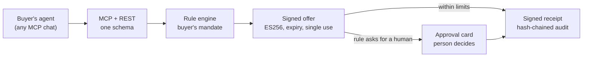

# Implementation and partner technologies

This page describes what we built for the Valio Aimo challenge and how we used the Junction 2026 partner technologies.
The contract is in [specs](specs.md), the product in the [PRD](prd.md), and the limits of the demo in [submission](submission.md#what-the-demo-proves-and-what-it-does-not).

## What we built

Trusted Trade Agents is an ordering service that the wholesaler hosts for the buyer's AI agent.
A chef speaks an order in the kitchen. The agent finds the products, gets a signed offer and places the order.
The wholesaler's server checks every rule. A person decides when a rule asks for a human.

- **Open discovery.** An agent reads `/.well-known/trusted-trade.json` and finds the MCP endpoint, the OpenAPI 3.1 document, the public keys (JWKS), the ordering skill and the reason codes.
- **The server checks the rules.** The buyer's limits are an AP2-style mandate. Thirteen reason codes send an order to a person, for example spend limit, substitute, new product or unconfirmed allergen. Eight more reject it, for example an invalid or expired offer. The agent cannot skip a check or approve its own order: the decision tools are visible only to the approval card.
- **Signed offers and receipts.** Each offer is an ES256 JWS with an ID and an expiry, and each offer works once. Anyone can verify it with the published key. Each order gets a signed receipt that covers the latest entry of a SHA-256 audit hash chain.
- **The person fixes the order instead of rejecting it.** On the approval card the approver changes an amount, picks another product or reduces an over-limit order to fit. The server gets new signed offers and runs every check again. A proposal version makes sure that only one decision counts.
- **The agent earns trust.** After a buyer approves the same substitute three times, the card asks: "Let the agent do this without asking?" Yes adds a rule for that product pair to the buyer's mandate, and later orders go through with an audit line that says why. "Don't suggest again" adds a rule that blocks the substitute. Only the buyer can add or remove these rules, in the agent limits view.
- **Short stock is handled.** Offers give part of the order from stock and ranked substitutes for the rest, or a split delivery.
- **Hard constraints.** All GS1 allergens, free-from claims and vegan are hard constraints. Search returns only products that can arrive by the requested date.
- **Time safety.** A job declines pending orders when their cut-off passes. Expired offers or a changed mandate get new offers before approval.
- **Views in the chat.** Five MCP App views (search results, offer comparison, agent limits, order timeline and approval card) are Lit web components in a sandboxed frame. Valio Aimo controls how they look and work in every host. They show the agent's reasons and the trust chain, in English and Finnish.

Stack: Bun, Elysia, Eden, Drizzle on PostgreSQL, React, Lit, the MCP SDK with MCP Apps, and jose.
The code is a modular monolith of bounded contexts in `contexts/`.

## Partner technologies

| Partner         | Role                                       | Status                                   |
| --------------- | ------------------------------------------ | ---------------------------------------- |
| NVIDIA Nemotron | The buyer agent's model in the chat host   | Live demo                                |
| OpenAI Codex    | Coding agents and the independent reviewer | Development, about 280 commits on `main` |
| Vultr           | App server, chat host and CI runners       | Live demo and CI                         |
| Tiger Data      | Managed PostgreSQL for the demo            | Live demo                                |
| ElevenLabs      | Spoken replies in the voice chat           | Spike; not set up on the hosted demo     |

### NVIDIA Nemotron 3.5 Super VL

**Model.** `nemotron-3.5-super-vl`, served by Verda on a B300 GPU container through an OpenAI-compatible endpoint ([#172](https://github.com/Jaahuo/junction-2026-trusted-trade-agents/issues/172), [PR #193](https://github.com/Jaahuo/junction-2026-trusted-trade-agents/pull/193)).

**What it does.** Nemotron is the buyer's agent in the hosted Open WebUI workspace for two fictional customers, Acme Kitchens and Acme Bakery ([Open WebUI workspace](openwebui.md)).
It turns a chef's sentence or a recipe plan into an order:

1. It calls our MCP tools to search the catalogue with the buyer's constraints.
2. It gets signed offers.
3. It places the order.

When a rule stops the order, it explains the reason to the chef and shows the approval card.
It also plans amounts from recipes with a deterministic arithmetic tool.

**Why it matters.** The model does the work a buyer does today by hand: it reads an informal request and chooses products, amounts and a delivery date.
The server then checks every choice, so a wrong model choice cannot become an unchecked order.

**How we improved its outputs.**

- The system prompt embeds the project's ordering skill and the reason codes, so the model explains a stop in the server's terms.
- A browser check ([`scripts/chat-check.ts`](../scripts/chat-check.ts)) sends the demo sentences to the model in Open WebUI. It reports the tool calls, the stored order and the reply.
- The check found that about one reply in seven stopped inside the model's reasoning, because the 4,096-token output limit ran out. We raised it to 16,384. After that, the check passed 7 of 7 scenarios twice in a row on Nemotron ([#290](https://github.com/Jaahuo/junction-2026-trusted-trade-agents/issues/290), [PR #297](https://github.com/Jaahuo/junction-2026-trusted-trade-agents/pull/297)).
- We changed the tools so that a model has less to copy and less to guess:
  - An order takes a short offer ID, not the 1,350-character signed token ([#162](https://github.com/Jaahuo/junction-2026-trusted-trade-agents/issues/162)).
  - The server generates the idempotency keys ([PR #293](https://github.com/Jaahuo/junction-2026-trusted-trade-agents/pull/293)).
  - "Quiet" versions of search and offers let the chat show only the order card.
- We fixed the prompt and the skill where host tests found wrong replies ([#166](https://github.com/Jaahuo/junction-2026-trusted-trade-agents/issues/166)):
  - Do not say "Done" while an order waits for a person.
  - Do not order a product whose name does not carry the stated dietary need.
  - Search again before asking.
  - Say one status sentence when the order card shows.

### OpenAI Codex

Codex models did most of the development, in the OhMyPi agent harness and as a reviewer next to Claude Code.

- **Orchestration and implementation.** 49 of 52 main OhMyPi sessions ran on `gpt-6.1-sol`. 377 subagent sessions ran on `gpt-6.1-sol` (159) and `gpt-6.1-terra` (218). They ran delivery waves in parallel worktrees, and plan, code, adversarial and security reviews.
- **Independent review.** In Claude Code sessions, Codex reviewed diffs, plans and approaches: about 126 reviews and about 171 recorded findings, of which 156 were fixed.
  Example: a hosted database reset used `DROP … CASCADE`. After the Codex finding, the reset drops an exact list of our tables in one transaction, with a test that fails first.
- **Process.** A high-impact PR needs a review by a different agent, with the reviewer's model in the PR evidence ([workflow](workflow.md)). Issues are the task state, and each task has its own worktree. The [`backlog-loop`](../.agents/skills/backlog-loop/SKILL.md) skill picks, builds, checks and ships ready issues.

The counts come from the local agent session logs.

### Vultr

- **App server.** OpenTofu ([`infra/`](../infra/)) creates one `vc2-2c-4gb` instance in Frankfurt with Ubuntu 24.04, a firewall and Caddy for TLS. It serves the API, the web app, the MCP endpoint and the Open WebUI chat host ([deploy](deploy.md), [#84](https://github.com/Jaahuo/junction-2026-trusted-trade-agents/issues/84)).
- **Continuous deployment.** Every push to `main` deploys after the gate passes. The images are private and immutable, with SBOMs and verified promotion ([#130](https://github.com/Jaahuo/junction-2026-trusted-trade-agents/issues/130)).
- **CI runners.** Self-hosted `junction-ci` runners on a Vultr host run every gate and deploy job, with Docker layer caches kept on the runner ([PR #301](https://github.com/Jaahuo/junction-2026-trusted-trade-agents/pull/301), [#303](https://github.com/Jaahuo/junction-2026-trusted-trade-agents/issues/303)).

### Tiger Data

- **Database.** A managed PostgreSQL service on Tiger Cloud (`eu-central-1`, 0.5 CPU, 2 GB), created with the `timescale/timescale` OpenTofu provider next to the Vultr instance ([#37](https://github.com/Jaahuo/junction-2026-trusted-trade-agents/issues/37), [#84](https://github.com/Jaahuo/junction-2026-trusted-trade-agents/issues/84)).
- **What it holds.** The data of all nine bounded contexts: the catalogue, mandates, offers, orders and the hash-chained audit log. The Drizzle migrations run on it without change.
- **Reset.** Tiger Data keeps the TimescaleDB extension in `public`, so the hosted reset drops only our own tables ([`apps/api/src/remote-reset.ts`](../apps/api/src/remote-reset.ts)).
- **Not used.** The demo does not use time-series features.

### ElevenLabs

- **Spike.** The spike ([#45](https://github.com/Jaahuo/junction-2026-trusted-trade-agents/issues/45)) tested voice as the main interface. A restaurant buyer interview raised the idea: a chef's hands and attention are busy ([#44](https://github.com/Jaahuo/junction-2026-trusted-trade-agents/issues/44)).
- **Result.** In an Open WebUI voice call, a spoken request called `search_products` on our MCP server and the search view rendered. ElevenLabs `eleven_multilingual_v2` read the reply with the premade voice "Sarah" ([measured results](host-support.md#measured-results)).
- **Privacy.** Speech-to-text ran locally with faster-whisper, so no audio left the machine.
- **Approval stays a tap.** The approval is always a person's tap on the card, never a spoken "approve".
- **Hosted demo.** The hosted chat host has no TTS provider configured ([Open WebUI workspace](openwebui.md)).
